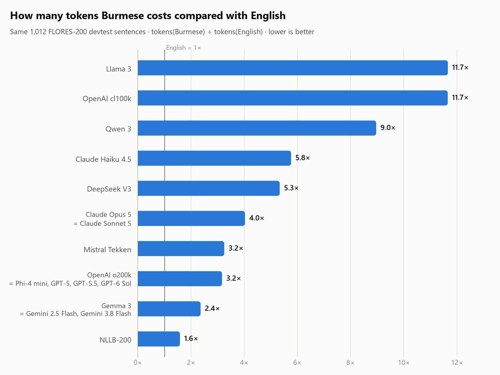
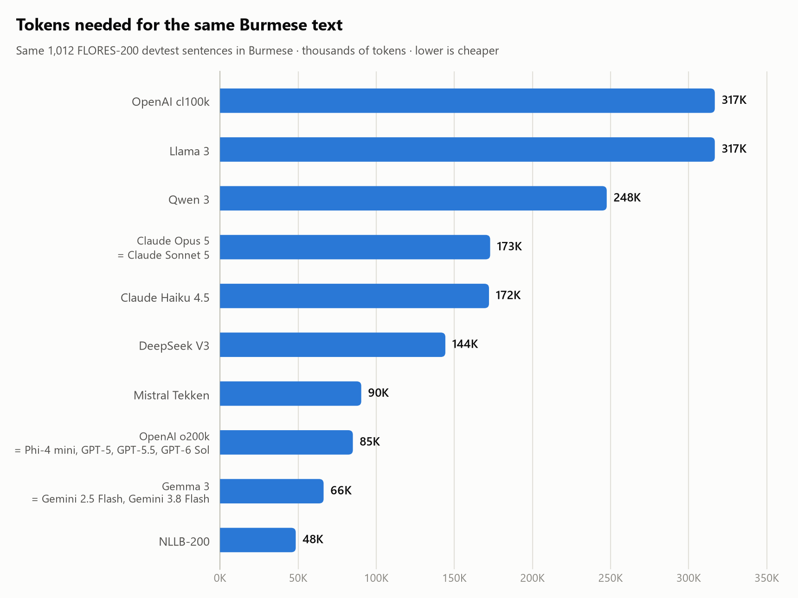

# Burmese pyas more than its neighbours

**How many tokens do AI models spend on Burmese?**

The same sentence in Burmese can cost **up to 11.7× more tokens** than in English.
This benchmark measures that "language tax" across popular LLM tokenizers, including
GPT-5/6, Claude and Gemini through their official token counters.



## Why this matters

LLMs don't read letters or words. They read **tokens**, and almost everything is priced in tokens:

- 💸 **Cost:** APIs charge per token, so the same question in Burmese can cost several times more.
- 🐢 **Speed:** models generate one token at a time, so Burmese answers take longer.
- 📦 **Context:** a 128K-token window holds far less Burmese text than English.

Most tokenizers learned their vocabulary mostly from English. Burmese script is rare in that data,
so it gets chopped into tiny pieces, sometimes a single byte per token. For example, GPT-4's
`cl100k` tokenizer spends **12 tokens** on the one word `မြန်မာ` (Myanmar).

## Key findings

From the FLORES-200 devtest run (1,012 sentences, September 2026):

- **Google is cheapest for Burmese.** Gemini 2.5 Flash and Gemini 3.8 Flash give exactly the same
counts as Gemma 3, so they share one tokenizer: **2.4×** English, the best of any chat model.
- **OpenAI hasn't changed tokenizers since GPT-4o.** GPT-5, GPT-5.5 and GPT-6 Sol all match `o200k`
exactly: **3.2×**. Mistral's Tekken is about the same.
- **Claude uses about twice as many Burmese tokens as GPT-5.** The same Burmese text is ~173K
tokens with Claude vs 85K with GPT-5 and 66K with Gemini. Claude Opus 5 and Sonnet 5 share a newer
tokenizer whose "tax" looks lower (4.0× vs 5.8× for Haiku 4.5), but only because it uses 44% more
tokens on *English*; Burmese costs the same ~172K either way.
- **Older tokenizers are the worst.** GPT-4 / GPT-3.5 (`cl100k`) and **Llama 3** need **11.7×**
the tokens for Burmese, close to one token per byte. Llama 3 extends `cl100k`, but its extra
tokens don't cover Burmese.
- **Qwen 3 (9.0×) and DeepSeek V3 (5.3×)** are also expensive for Burmese, although they handle
Chinese at about 1× English.
- **NLLB-200** (Meta's translation model built for 200 languages) shows what's possible: **1.6×**.
- **Burmese pays more than its neighbours.** With every tokenizer, Thai costs less than
Burmese; Khmer and Lao are often just as bad or worse.

The "tax" compares each tokenizer with itself. To compare **providers**, look at absolute tokens
for the same Burmese text (and multiply by each provider's price per token):



A lower number means cheaper, faster and more room in the context window, but **it doesn't
measure answer quality.** A tokenizer can be efficient and the model can still write poor Burmese.

## Full results

*Dataset: FLORES-200 devtest · 1012 parallel sentences · run 2026-09-29*

**Burmese needs 1.6× to 11.7× as many tokens as English** for the same sentences. With the least efficient tokenizer (Llama 3), the same Burmese text costs 11.7× more, runs about 11.7× slower to generate, and a 128K context window holds 408 Burmese sentences instead of 4,766 English ones.

### Burmese vs English


| Tokenizer        | Used by                                                        | English tokens | Burmese tokens | Burmese tax | Tokens / syllable | Sentences in 128K (Burmese / English) |
| ---------------- | -------------------------------------------------------------- | -------------- | -------------- | ----------- | ----------------- | ------------------------------------- |
| NLLB-200         | NLLB translation models (reference: trained for 200 languages) | 30,641         | 48,473         | **1.58×**   | 0.97              | 2,672 / 4,227                         |
| Gemma 3          | Gemma 3                                                        | 28,125         | 66,306         | **2.36×**   | 1.33              | 1,953 / 4,605                         |
| Gemini 2.5 Flash | Gemini 2.5                                                     | 28,125         | 66,306         | **2.36×**   | 1.33              | 1,953 / 4,605                         |
| Gemini 3.8 Flash | Gemini 3.8                                                     | 28,125         | 66,306         | **2.36×**   | 1.33              | 1,953 / 4,605                         |
| OpenAI o200k     | GPT-4o, GPT-4.1, o-series, gpt-oss                             | 26,878         | 85,034         | **3.16×**   | 1.70              | 1,523 / 4,819                         |
| Phi-4 mini       | Phi-4 mini                                                     | 26,878         | 85,034         | **3.16×**   | 1.70              | 1,523 / 4,819                         |
| GPT-5            | GPT-5                                                          | 26,878         | 85,034         | **3.16×**   | 1.70              | 1,523 / 4,819                         |
| GPT-5.5          | GPT-5.5                                                        | 26,878         | 85,034         | **3.16×**   | 1.70              | 1,523 / 4,819                         |
| GPT-6 Sol        | GPT-6 Sol                                                      | 26,878         | 85,034         | **3.16×**   | 1.70              | 1,523 / 4,819                         |
| Mistral Tekken   | Mistral Nemo and later                                         | 27,832         | 90,406         | **3.25×**   | 1.81              | 1,432 / 4,654                         |
| Claude Opus 5    | Claude Opus 5                                                  | 42,927         | 172,929        | **4.03×**   | 3.46              | 749 / 3,017                           |
| Claude Sonnet 5  | Claude Sonnet 5                                                | 42,927         | 172,929        | **4.03×**   | 3.46              | 749 / 3,017                           |
| DeepSeek V3      | DeepSeek V3 / R1                                               | 27,046         | 144,243        | **5.33×**   | 2.89              | 898 / 4,789                           |
| Claude Haiku 4.5 | Claude Haiku 4.5                                               | 29,894         | 172,181        | **5.76×**   | 3.45              | 752 / 4,333                           |
| Qwen 3           | Qwen 3                                                         | 27,626         | 247,546        | **8.96×**   | 4.96              | 523 / 4,688                           |
| OpenAI cl100k    | GPT-4, GPT-3.5                                                 | 27,187         | 316,731        | **11.65×**  | 6.34              | 408 / 4,764                           |
| Llama 3          | Llama 3.x                                                      | 27,176         | 316,730        | **11.65×**  | 6.34              | 408 / 4,766                           |


Identical counts in every language, so these share one tokenizer: OpenAI o200k = Phi-4 mini = GPT-5 = GPT-5.5 = GPT-6 Sol; Gemma 3 = Gemini 2.5 Flash = Gemini 3.8 Flash; Claude Opus 5 = Claude Sonnet 5.

### Every language (tokens as a multiple of English)


| Tokenizer        | Burmese    | Thai  | Khmer  | Lao    | Hindi | Vietnamese | Chinese (Simplified) |
| ---------------- | ---------- | ----- | ------ | ------ | ----- | ---------- | -------------------- |
| NLLB-200         | **1.58×**  | 1.52× | 1.78×  | 1.47×  | 1.21× | 1.18×      | 1.09×                |
| Gemma 3          | **2.36×**  | 1.58× | 2.67×  | 2.56×  | 1.30× | 1.36×      | 1.08×                |
| Gemini 2.5 Flash | **2.36×**  | 1.58× | 2.67×  | 2.56×  | 1.30× | 1.36×      | 1.08×                |
| Gemini 3.8 Flash | **2.36×**  | 1.58× | 2.67×  | 2.56×  | 1.30× | 1.36×      | 1.08×                |
| OpenAI o200k     | **3.16×**  | 1.99× | 3.34×  | 8.23×  | 1.57× | 1.49×      | 1.25×                |
| Phi-4 mini       | **3.16×**  | 1.99× | 3.34×  | 8.23×  | 1.57× | 1.49×      | 1.25×                |
| GPT-5            | **3.16×**  | 1.99× | 3.34×  | 8.23×  | 1.57× | 1.49×      | 1.25×                |
| GPT-5.5          | **3.16×**  | 1.99× | 3.34×  | 8.23×  | 1.57× | 1.49×      | 1.25×                |
| GPT-6 Sol        | **3.16×**  | 1.99× | 3.34×  | 8.23×  | 1.57× | 1.49×      | 1.25×                |
| Mistral Tekken   | **3.25×**  | 2.40× | 14.74× | 12.65× | 1.80× | 1.43×      | 1.40×                |
| Claude Opus 5    | **4.03×**  | 2.64× | 3.97×  | 3.97×  | 2.16× | 1.82×      | 1.14×                |
| Claude Sonnet 5  | **4.03×**  | 2.64× | 3.97×  | 3.97×  | 2.16× | 1.82×      | 1.14×                |
| DeepSeek V3      | **5.33×**  | 1.80× | 6.83×  | 7.97×  | 2.79× | 2.12×      | 0.94×                |
| Claude Haiku 4.5 | **5.76×**  | 3.77× | 5.66×  | 5.65×  | 3.10× | 2.38×      | 1.61×                |
| Qwen 3           | **8.96×**  | 2.58× | 6.50×  | 5.69×  | 4.43× | 1.44×      | 1.00×                |
| OpenAI cl100k    | **11.65×** | 4.38× | 8.75×  | 9.54×  | 4.77× | 2.44×      | 1.87×                |
| Llama 3          | **11.65×** | 2.21× | 8.75×  | 8.79×  | 2.52× | 1.39×      | 1.28×                |


Raw numbers: `[results/results.csv](results/results.csv)` · `[results/results.json](results/results.json)`

## How it works

1. **Parallel text.** [FLORES-200](https://github.com/facebookresearch/flores) devtest: the same 1,012
  sentences professionally translated into 200 languages. Because the meaning is identical,
   token counts can be compared directly.
2. **Tokenize** every language's full text (sentences joined by newlines) with each tokenizer,
  without special tokens.
3. **Burmese tax** = `tokens(Burmese) ÷ tokens(English)` for the same tokenizer.
  We also report tokens per Burmese syllable (~1 is ideal; 6 means it's close to byte level)
   and how many sentences fit in a 128K context.


| Tokenizer           | Used by                                                      | Loaded from                                                       |
| ------------------- | ------------------------------------------------------------ | ----------------------------------------------------------------- |
| OpenAI o200k        | GPT-4o, GPT-4.1, GPT-5 to GPT-6 (confirmed via API), gpt-oss | `tiktoken`                                                        |
| OpenAI cl100k       | GPT-4, GPT-3.5                                               | `tiktoken`                                                        |
| Llama 3             | Llama 3.x                                                    | `unsloth/Llama-3.2-1B-Instruct` (public mirror of the gated repo) |
| Gemma 3             | Gemma 3                                                      | `unsloth/gemma-3-1b-it` (public mirror)                           |
| Qwen 3              | Qwen 3                                                       | `Qwen/Qwen3-8B`                                                   |
| DeepSeek V3         | DeepSeek V3 / R1                                             | `deepseek-ai/DeepSeek-V3`                                         |
| Mistral Tekken      | Mistral Nemo and later                                       | `unsloth/Mistral-Nemo-Instruct-2407` (public mirror)              |
| Phi-4 mini          | Phi-4 mini                                                   | `microsoft/Phi-4-mini-instruct` (uses `o200k`)                    |
| NLLB-200            | NLLB translation models                                      | `facebook/nllb-200-distilled-600M`                                |
| Claude              | Opus 5, Sonnet 5, Haiku 4.5                                  | Anthropic `count_tokens` API (`--api`)                            |
| GPT-5 / 5.5 / 6 Sol | OpenAI's newest models                                       | OpenAI `responses/input_tokens` API (`--api`)                     |
| Gemini              | 2.5 Flash, 3.8 Flash                                         | Gemini `countTokens` API (`--api`)                                |


Only the tokenizer files are downloaded, not the models. The API token counters are free to call;
the fixed message framing they add is measured once and subtracted. As a check, GPT-5 via the API
matches local `o200k` exactly, and Gemini matches local Gemma 3 exactly.

## Run it yourself

```bash
git clone https://github.com/aungthuhein2005/myanmar-tokenizer-bench
cd myanmar-tokenizer-bench
pip install -e .
mtb run
```

This downloads FLORES-200 (~24 MB) and the tokenizer files, then rewrites `results/` and the
results table in this README.

```bash
mtb list                                  # available tokenizers
mtb run --tokenizers o200k gemma3         # just some tokenizers
mtb run --langs mya_Mymr tha_Thai         # just some languages (English is always included)
mtb run --api                             # also Claude, GPT-5/6 and Gemini via their APIs
mtb run --corpus my_texts/                # your own parallel corpus: my_texts/eng_Latn.txt, mya_Mymr.txt, ...
mtb report                                # rebuild charts + tables from results/results.json
```

For `--api`, put your keys in a `.env` file (it's git-ignored). Missing keys just skip that provider:

```
ANTHROPIC_API_KEY=...
OPENAI_API_KEY=...
GEMINI_API_KEY=...
```

To add a tokenizer, add one line to `[mtb/registry.py](mtb/registry.py)`.

## Limitations

- FLORES is news/wiki-style text. Chat, code or informal Burmese may tokenize differently.
- All Burmese here is **Unicode**. Zawgyi text isn't measured yet (see roadmap).
- Mirrored tokenizers are assumed identical to the official ones; they are the same files, re-hosted.
- API models are counted as of the run date; providers can change tokenizers with new models.


## Roadmap

- [ ] Claude, GPT-5/6 and Gemini results
- [ ] Zawgyi vs Unicode token counts
- [ ] Southeast Asia-focused models (Sailor2, SeaLLM, SEA-LION)
- [ ] A cost calculator: "this Burmese document costs $X with model Y"
- [ ] An interactive leaderboard page

Contributions welcome, especially new tokenizers and Burmese text from other domains.

## License

Code: MIT. The results are derived from [FLORES-200](https://github.com/facebookresearch/flores)
(CC BY-SA 4.0); the dataset itself isn't redistributed here.